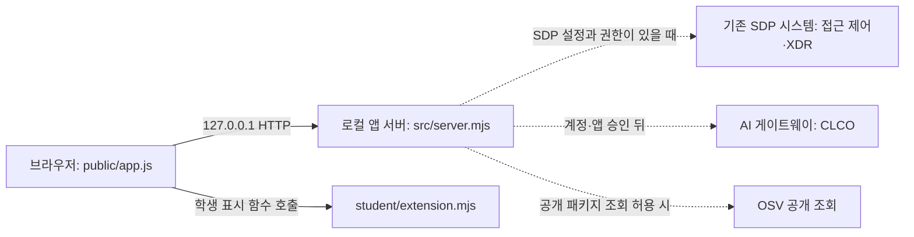

# 히득키득 학생 실행 설명서와 구성도

이 문서는 다른 사람이 **앱 실행 위치와 명령을 확인**하도록 만든 학생 문서입니다. 앱을 켰다는 사실과 SDP 접근 제어·XDR, AI 설명, 보안 조치, OSV 조회가 성공했다는 판단은 별개입니다. 제공 파일을 수정하거나 개인 설정·열쇠를 문서에 옮기지 않습니다.

## 1. 목적, 기능, 확인된 환경

히득키득은 케셰브 시작 틀을 바탕으로 한 로컬 보안 Agent 화면입니다. 제공 화면에는 「보호 현황」, 「업무 앱」, 「보안 기록」이 있으며, 학생 코드 `student/extension.mjs`는 전달받은 판정·기록·AI·조치·패키지 조회 상태를 별도 영역에 표시합니다. AI 요약과 제안은 참고 정보이며 집행 명령이 아닙니다.

| 구분 | 현재 확인한 사실 | 확인 범위 |
|---|---|---|
| 제출용 GitHub 저장소 `anseokju02/keshev-security-agent` | 저장소 루트의 `package.json`은 `alekov-client-starter@0.2.14`; `package-lock.json`은 저장소에 없음. 외부 npm 의존성은 `package.json`에 선언되지 않음 | 저장소 파일 확인. 이 원문을 새 Windows PC에서 직접 실행한 결과는 미확인 |
| 학생 PC 앱 폴더 | `C:\Users\User\Desktop\Aleph 방어전 13단계 준비\on-client`; 새 PowerShell에서 읽은 `package.json` 버전은 `0.2.21`이고 `npm.cmd run check` 출력도 `alekov-client-starter@0.2.21` | 학생이 제공한 PowerShell 출력과 앱 화면 |
| Node.js | 새 PowerShell 창의 `node --version`은 `v24.22.0`. 이전 실행 도구 화면에서는 `v24.19.0`을 확인했음. 저장소 `package.json`의 `engines.node`는 `24.19.0`, 실행 도구 코드는 Node.js 22~24를 허용하고 24.19.0을 수업 기준으로 안내 | 24.19.0에서 앞선 실행·문법 검사 확인, 24.22.0에서 새 창으로 로컬 앱 재시작 및 브라우저 표시 확인. 다른 버전은 미확인 |
| 실행 환경 | Windows PowerShell에서 `tools/start-alekov.ps1` 사용, PC 브라우저에서 `http://127.0.0.1:5189/` 화면 확인 | PowerShell과 브라우저 화면 확인. PowerShell·브라우저의 세부 버전은 미확인 |

**버전 차이:** PC에서 사용한 0.2.21 제공 파일 전체가 위 GitHub 저장소에 올라간 것은 아닙니다. 저장소의 시작 틀은 0.2.14이고 학생 함수만 단계별로 반영했습니다. 따라서 이 문서의 *PC 확인 결과*를 저장소 0.2.14를 새로 복제해 실행한 결과로 읽지 마세요. 0.2.21 업데이트의 보존 절차는 운영자가 배포한 안내와 `docs/STARTER_UPDATE.md`를 따르며, 학생 파일과 Git 기록을 덮어쓰지 않습니다.

## 2. 파일 위치와 준비

| 위치 | 역할 |
|---|---|
| 저장소 루트의 `README.md`, `package.json`, `.env.example` | 제공 개요·실행 스크립트·비밀 없는 설정 견본 |
| `tools/start-alekov.ps1` | 앱 폴더·Node 버전·포트를 확인하고 `src/server.mjs`를 실행하는 제공 도구 |
| `src/server.mjs`, `src/engine/**`, `src/ai/**`, `src/actions/**`, `src/vulnerabilities/**` | 제공 서버, 기존 SDP 시스템 연결, AI 경계, 조치 경계, 패키지 조회 |
| `public/index.html`, `public/app.js`, `public/vulnerabilities-view.mjs` | 제공 브라우저 화면·요청·조회 취소·결과 검증 |
| `student/extension.mjs` | 학생이 작성한 상태·근거 표시 함수 |
| `docs/STUDENT_RUNBOOK.md` | 이 학생 문서 |

GitHub 저장소 루트에는 `on-client` 디렉터리가 따로 없고, 위 파일들이 바로 있습니다. 반면 학생 PC에서는 위 파일들의 실행 복사본을 `…\on-client` 폴더에서 사용합니다. 학생 PC의 `on-client`에서 `git rev-parse --show-toplevel`을 실행한 결과는 `C:\Users\User\Desktop\Aleph 방어전 13단계 준비`였습니다. 즉 PC의 Git 최상위는 앱 폴더의 **상위 프로젝트 폴더**입니다. 이 PC 작업 폴더와 위 GitHub 저장소의 구조가 서로 다르므로 같은 Git 원격·커밋이라고 아직 단정하지 않습니다. 실행 명령은 Git 최상위가 아니라 **앱 폴더**에서 수행합니다.

2026-10-28 PC에서 `git status --short --branch`를 읽은 결과 `main`에 기존 수정(` M`)과 미추적(`??`) 파일이 다수 있습니다. 그 파일들의 내용을 검토하거나 한꺼번에 스테이징·초기화하지 않았습니다. 이 문서는 그 작업 트리 전체를 제출용 GitHub 커밋과 동일하다고 주장하지 않습니다.

필요 프로그램은 Windows PowerShell, Node.js 및 PC 브라우저입니다. 시작 틀의 `package.json`에는 외부 npm 패키지가 없어 이 실행 절차에 임의의 `npm install`을 추가하지 않습니다. 처음 설치하거나 업데이트해야 한다면 ALEPH의 공식 시작 틀과 보존 업데이트 안내를 사용합니다. 이 문서는 다운로드 ZIP이나 학생 파일을 강제로 덮어쓰는 명령을 제공하지 않습니다.

비밀값과 개인 자격 파일은 프로젝트·Git·제출물 밖에 두고, `.env.example`의 견본을 실제 열쇠로 채운 채 커밋하지 않습니다. `-NativeHostConfig`와 `-SdpHostConfig`는 서로 다른 연결 설정을 받는 **제공 실행 도구의 선택 옵션**입니다. 실제 파일 경로·내용은 여기에 쓰지 않습니다. 일반적인 화면 확인에 임의로 설정 파일을 만들거나 SDP 권한을 부여하지 않습니다.

## 3. 앱 켜기, 확인, 종료, 재실행

1. 실행 중인 같은 앱이 있으면 그 앱의 PowerShell 창에서 `Ctrl+C`로 종료합니다. 기존 작업 파일은 지우지 않습니다.
2. 파일 탐색기에서 학생 PC의 `C:\Users\User\Desktop\Aleph 방어전 13단계 준비\on-client`를 열고, 주소 표시줄에 `powershell`을 입력한 뒤 Enter를 누릅니다. 다른 PC에서는 **실제 on-client 폴더**를 먼저 확인합니다.
3. 열린 창의 경로가 `on-client`인지 확인하고 아래 명령을 실행합니다.

```powershell
powershell -NoProfile -ExecutionPolicy Bypass -File .\tools\start-alekov.ps1
```

4. 실행 도구 코드의 정상 시작 안내는 `케셰브가 켜졌습니다. 브라우저에서 http://127.0.0.1:5189/ 을 여세요.`와 `서버가 응답한 것만 확인했습니다. AI 연결 상태는 화면에서 따로 확인해 주세요.`입니다. 실제 PC에서는 새 PowerShell에서 실행 후 브라우저 화면이 열린 것을 확인했습니다. 이번 재실행의 **PowerShell 안내 문구 원문은 아직 확인하지 않았습니다**. 브라우저 응답은 계정·SDP·AI 연결 완료가 아닙니다.
5. 브라우저에서 `http://127.0.0.1:5189/`를 엽니다. 「보호 현황」, 「업무 앱」, 「보안 기록」 탭과 제공/학생 표시 영역을 확인합니다. `disconnected`는 연결 없음, `demo`는 예제 자료입니다.
6. 종료는 실행한 PowerShell 창에서 `Ctrl+C`입니다. 재실행은 같은 앱 폴더에서 3번의 명령을 다시 실행하고 브라우저를 새로고침합니다. 포트 충돌 시 실행 도구는 기존 프로그램을 종료하지 않고 다른 포트를 안내합니다. `-Port 5190`과 같은 옵션은 코드에 있으나 이 PC에서의 사용 결과는 미확인입니다.

문법 확인만 할 때는 같은 앱 폴더에서 `npm.cmd run check`를 실행합니다. 이 명령은 `node --check student/extension.mjs`만 실행하며 연결·기능·과제 통과를 검사하지 않습니다. 계정 연결을 사용하는 PC 실행에는 `npm start` 대신 위 실행 도구를 사용했습니다.

## 4. 글로 쓴 시스템 구성도와 데이터 흐름



브라우저의 `public/app.js`는 같은 PC의 로컬 서버에 요청하고, 제공 UI의 현재 상태를 `student/extension.mjs`의 표시 함수에 전달합니다. 학생 함수는 결과를 글자로 표시하며 인증·원천 조회·AI 요청·집행 요청을 직접 보내지 않습니다. 서버의 `src/engine/**`은 설정된 경우에만 기존 SDP의 본인 범위 조회와 업무 앱 판정을 연결합니다. `src/ai/**`와 `src/connection/**`은 계정 연결과 AI 앱 권한·설명 경계에 관여합니다. `src/actions/**`은 사람이 확인한 조치의 원천 결과를 다루는 제공 경계입니다. `src/vulnerabilities/**`은 운영자가 허용한 공개 패키지에 대해서만 lock 파일과 설치 메타데이터를 대조한 뒤 OSV 조회를 시도합니다.

점선은 **조건부 경로**이며 현재 PC에서 모두 활성화되었다는 표시가 아닙니다. 기본 실행에 SDP 연동이 없으면 `ENGINE_NOT_CONNECTED`이고, 20단계 화면에서 관찰한 `PROJECT_NOT_CONFIGURED`는 OSV 조회 대상 프로젝트가 준비되지 않은 상태입니다. `supportedActions`가 빈 배열인 기록에는 실제 조치 경로가 열리지 않습니다. 앱이 켜짐, AI 모델 목록 `verified`, 사건 설명 성공, 보안 조치 효과 관측은 각각 별도로 확인합니다.

### 제공 코드와 학생 코드의 경계

| 파일·함수 | 역할과 받은 입력 | 이 코드만으로 확인할 수 없는 것 |
|---|---|---|
| 제공 `tools/start-alekov.ps1`, `src/server.mjs` | Node·포트 확인 후 로컬 서버를 열고 API 요청을 처리 | 원천 시스템·AI 연결 성공 |
| 제공 `public/app.js`, `public/vulnerabilities-view.mjs` | 버튼, HTTP 요청, 취소, 새로고침, 응답 검증, 학생 함수 호출 | 학생 표시 코드의 과제 판정 |
| 학생 `renderIdentity({ me, devices, sessions })` | 현재 사용자·기기·세션과 상태·목록 표시 | 실제 SDP 신원 연결의 발급·인증 |
| 학생 `renderDecision({ status, mode, data, error, appId })` | 선택 앱의 `allow`·`deny`·`challenge`·`unknown` 판정과 이유·시각 표시 | 원천 업무 앱 리소스 접속 성공 |
| 학생 `renderEvents({ status, mode, data, error })` | 본인 접속·XDR 기록 필터와 사건의 근거·규칙·상태 상세 표시 | 화면의 기록이 없는 경우 원천에 사건이 전혀 없다는 단정 |
| 학생 `renderStatus({ devices, sessions, notifications, diagnostics, mode })` | 기기·현재 세션·알림·도움정보 상태 표시 | 연결 실패를 정상 상태로 바꾸는 권한 |
| 학생 `renderAiConnection({ status, mode, data, error, checkedAt })` | `verified`/시험 점검과 응답 모델 수·오류 표시 | 실제 사건 설명을 실행하거나 통과시킨 결과 |
| 학생 `renderExplanation({ event, explanation, checkedAt })` | 선택 사건의 근거 ID·규칙·`unknown` 상태와 참고용 AI 요약·미실행 제안 표시 | 조치 실행. 성공한 설명에만 `data-student-explanation-event`를 붙임 |
| 학생 `renderAction({ status, event, actionId, target, receipt, observation, message, confirmationExpiresAt, error })` | 준비·전송·접수(ACK)·결과 불명·관측된 효과를 구분 | ACK를 실제 효과로 인정하거나 직접 집행. `observation.effectApplied === true`인 검증 결과에서만 성공 표식 |
| 학생 `renderVulnerabilities({ status, mode, data, error })` | 전체 `complete`·`partial`·`not_checked`·`not_configured`·`unverifiable` 및 각 패키지의 정확한 버전·출처·조회 시각·취약점 ID 표시 | `none_found`를 앱 안전 보장으로 해석. 패키지 행에는 `data-student-package-name`과 `data-student-package-version`을 붙임 |

학생 함수의 DOM은 받은 값을 `createElement`와 `textContent`로 표시합니다. 제공 화면의 「설치 패키지 조회」, 「패키지 조회 취소」, 「다시 불러오기」, 「현재 API 연결 점검」 같은 버튼은 학생 함수가 새로 만들지 않습니다. 학생 함수는 조회 실패를 빈 결과로 바꾸지 않으며, `unknown`을 정상이나 효과 없음으로 판정하지 않습니다.

## 5. 오류별 확인 순서

먼저 **PowerShell의 시작 메시지 → 브라우저의 제공 영역 → 학생 영역** 순서로 봅니다. 제공 영역의 오류 코드와 발생 시각을 확인하고, 이미 진행 중인 요청이나 결과 불명 상태를 무턱대고 새 성공으로 바꾸지 않습니다.

| 메시지·상태 | 학생이 확인할 것 | 남는 한계·다음 조치 |
|---|---|---|
| `Node.js 가 없습니다`, 버전 안내, `앱 폴더가 아닙니다` | 새 PowerShell 창의 위치와 `node --version`, `package.json`, `tools/start-alekov.ps1` 존재 여부 | 수업 기준 Node.js 24.19.0과 실제 앱 폴더를 확인한 뒤 다시 실행. 설치·환경 변경은 학생 본인 PC에서만 |
| `포트 5189 를 다른 프로그램이 쓰고 있습니다` | 같은 앱이 이미 켜져 있는지 확인 | 다른 프로그램을 강제 종료하지 않음. 제공 도구의 `-Port` 옵션을 쓰면 브라우저 주소도 같은 포트로 변경 |
| `계정 연결 설정을 확인하지 못했습니다`, `NATIVE_HOST_DISABLED` | `npm start`가 아닌 제공 실행 도구로 켰는지, 시작 틀 버전과 실행 위치 확인 | 기존 개인 설정·학생 파일을 삭제하거나 권한을 임의 변경하지 않음. 기존 설정이 이미 확인된 PC에서만 제공 옵션 `-NativeHostConfig`를 별도 안내에 따라 사용 |
| `ALEKOV_CONNECT_CONTEXT_CHANGED`, `ALEKOV_CONNECT_OUTCOME_UNKNOWN` | 「연결 도움정보 보기」의 안전한 코드·시각과 계정 연결 화면을 확인 | 승인·새 연결을 반복하지 않고 계정·프로젝트·세션 연속성과 승인 결과를 운영 담당자에게 문의. 과거에는 오류였으며 현재 연결의 성공으로 추정하지 않음 |
| `ENGINE_NOT_CONNECTED`, `CONTRACT_MISMATCH` | 「보호 현황」 상태와 「다시 불러오기」 한 번, 제공 도움정보 확인 | SDP 연결·응답 계약은 운영 설정 확인 대상. 연결 실패는 접근 거부 또는 빈 기록이 아님 |
| `PROJECT_NOT_CONFIGURED` / `not_configured` | 제공 패키지 조회 영역과 학생 영역의 전체 상태·확인 시각 비교 | 조회 대상 프로젝트 설정 필요. 20단계 PC 화면에서 실제로 관찰. 학생이 대상 경로·허용 패키지를 임의 변경하지 않음 |
| `not_checked`, `unverifiable`, `partial` | 미조회·lock 파일 확인 불가·일부 실패를 구분하고 받은 ID가 있으면 보존 | 이 PC에서 각각의 실제 OSV 결과는 미확인. `none_found`도 조회 범위에서 알려진 항목 없음일 뿐 안전 보장이 아님 |
| 패키지 `CANCELLED`, `TIMEOUT`, `CONTRACT_MISMATCH` | 제공 영역의 오류 코드와 학생 영역에 이전 표가 남지 않았는지 확인 | 필요하면 제공 화면의 「설치 패키지 조회」로 **직접** 다시 조회. 취소된 늦은 응답 차단은 제공 `public/app.js`의 세대 검사에 의존 |
| 조치 `pending`, `unknown` | `pending`의 ACK와 `unknown`의 결과 불명을 분리해 읽음 | ACK는 효과 확인이 아니며 `unknown`을 실패·성공으로 단정하지 않음. 「조치 화면 취소」는 이미 전달된 효과를 되돌리지 않음 |

오류가 반복되면 [제공 연결·문제 해결 문서](CONNECTION_TROUBLESHOOT.md)를 오류 코드로 찾습니다. 문의에는 화면 문구에서 비밀·개인정보를 가린 뒤 코드와 발생 시각만 사용합니다. 설정 파일 원문이나 확인 번호를 공유하지 않습니다.

## 6. 실제 확인·모의 점검·미확인 항목

| 구분 | 근거와 결과 |
|---|---|
| 코드로 읽음 | 이 저장소의 `package.json` 0.2.14, `package-lock.json` 부재, `tools/start-alekov.ps1`의 기본 포트·시작/종료 문구, `src/server.mjs`의 loopback 서버와 조건부 연결, `public/index.html` 버튼 이름, 학생 함수 입력 |
| PC 화면·PowerShell에서 확인 | 사용자 PC의 0.2.21 앱이 제공 도구로 켜짐, `npm.cmd run check`가 `node --check student/extension.mjs`로 오류 없이 종료. 새 창에서 Node.js `v24.22.0`·앱 `0.2.21`을 읽고 재실행한 뒤 `http://127.0.0.1:5189/`의 세 탭과 「연결 없음」 화면을 확인. 재실행 PowerShell의 시작 문구 원문은 미확인. 이전 화면에서 AI 앱 연결 후 `verified` 모델 수 1을 확인했으나 실제 사건 설명 실행과는 별개. 18단계는 사건 미선택 안내, 19단계는 `idle`·조치 미실행, 20단계는 `PROJECT_NOT_CONFIGURED`와 학생 `not_configured` 및 같은 확인 시각을 확인 |
| 모의 입력으로 점검 | 18단계의 근거·오류 표시, 19단계의 상태별 ACK/효과 구분과 새 입력 처리, 20단계의 `complete`·`partial`·미조회·오류, 부분 실패 ID 보존, 새 입력의 이전 행 제거. 실제 운영 연동 결과를 대신하지 않음 |
| 미확인 | 저장소 0.2.14를 새 Windows 환경에서 실행해 재현, PC Git 저장소의 기존 변경 내용·원격과 제출용 GitHub 저장소의 동일성, 실제 `package-lock.json`/설치 버전과 화면 행 대조, 운영 SDP 접속·기록·집행 효과, 실제 사건 AI 설명, OSV 공개 패키지 조회 및 취소 후 늦은 응답·오류 후 새 네트워크 요청 |

### 다른 사람이 직접 재현할 때의 대조

새 PowerShell 창을 **자신의 실제 앱 폴더**에서 연 뒤 `Get-Location`, `node --version`, `(Get-Content -LiteralPath .\package.json -Raw -Encoding UTF8 | ConvertFrom-Json).version`으로 위치·버전을 읽습니다. 이어 3장의 실행 도구 명령으로 앱을 켜고, 브라우저에서 주소와 「보호 현황」을 확인합니다. 폴더의 파일·버튼 이름이 표와 다르면 해당 항목을 **미확인**으로 기록하고 먼저 버전과 실제 경로를 맞춥니다. 실행을 새 PC에서 재현하기 전에는 이 문서의 PC 확인 사례를 그 PC의 결과로 옮겨 적지 않습니다.

21·22단계 제출은 별도 과제 화면의 저장소 주소·실제 40자리 커밋 입력 절차를 따릅니다. 비공개 저장소의 원문 전달 도구는 과제 화면에 표시된 **실제 Git 최상위·도구 위치·출력 폴더·커밋**을 확인한 뒤에만 사용합니다. 이 문서는 확인되지 않은 개인 PC 경로나 커밋을 넣은 `student-source-cli.mjs` 명령을 만들어 내지 않습니다. 원문 전달 완료와 AI 판정 통과는 서로 다릅니다.
